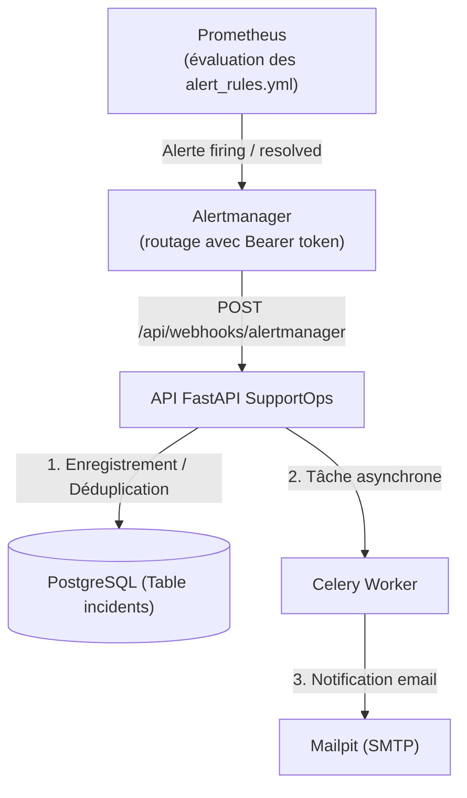

# SupportOps — Gestion des Incidents & Supervision

**Responsable :** Maryam  
**Périmètre :** Gestion automatisée des incidents, Webhook Alertmanager, Asynchrone Celery, Règles Prometheus & Monitoring.

---

## 1. Vue d'ensemble de la fonctionnalité

Conformément au cahier des charges (*SupportOps, Version 1.0, sections 2 & 3*), la gestion automatisée des incidents assure la détection des dysfonctionnements système, leur enregistrement dédupliqué en base de données, la notification asynchrone des équipes et le suivi de leur résolution jusqu'à la clôture.



---

## 2. Réalisations techniques

### A. Webhook Alertmanager & Logique Métier (`backend/app/`)
* **Endpoint Webhook authentifié** (`POST /api/webhooks/alertmanager`) :
  * Sécurisé par jeton `Bearer` via la variable d'environnement `ALERTMANAGER_WEBHOOK_SECRET` avec comparaison en temps constant (`secrets.compare_digest`).
* **Déduplication & Clé stable** :
  * Utilisation de la `fingerprint` Alertmanager : les alertes répétitives mettent à jour l'incident actif existant sans générer de doublons.
* **Cycle de vie de l'incident** :
  * `active` : lors de la réception d'une alerte `firing`.
  * `recovered` : marquage automatique lors de la réception d'une alerte `resolved`.
  * `closed` : validation et clôture définitive par un technicien ou administrateur (`POST /api/incidents/{id}/close`).
  * Réouverture autorisée : une nouvelle alerte avec la même clé après clôture crée un nouveau cycle d'incident distinct.

### B. Traitement Asynchrone Celery (`backend/app/tasks.py`)
* **Tâche Celery `notify_incident`** :
  * Déclenchée via `.delay(...)` immédiatement après l'enregistrement d'un nouvel incident en base pour ne pas bloquer la requête webhook.
  * Envoi d'un e-mail d'alerte détaillé (sévérité, alerte, résumé, lien direct Grafana) vers Mailpit.
  * Politiques de résilience : retry borné (`max_retries=3`, délai exponentiel de 60s).

### C. API de Consultation & Clôture (`backend/app/routers/incidents.py`)
* `GET /api/incidents` : listing des incidents triés par date de détection, avec filtres par statut (`active`, `recovered`, `closed`) et par sévérité.
* `POST /api/incidents/{id}/close` : endpoint sécurisé accessible uniquement aux rôles staff (`technician`, `admin`) avec horodatage `closed_at`.

### D. Socle Monitoring & Alertes (`monitoring/`)
* **`monitoring/alertmanager.yml`** :
  * Configuration du récepteur `supportops-webhook` avec support de `send_resolved: true` et en-tête d'authentification Bearer.
  * Paramètres de temporisation (`group_wait: 10s`, `repeat_interval: 5m`).
* **`monitoring/alert_rules.yml`** :
  * `HighErrorRate` : Alerte critique si le taux de codes HTTP 5xx dépasse 5% sur une fenêtre de 2 minutes.
  * `BackendServiceDown` : Alerte critique si le service API devient injoignable (`up == 0`).
  * `HighLatency` : Alerte d'avertissement si la latence P95 dépasse 500ms.

---

## 3. Tests et Validation

Une suite de tests automatisés (`pytest`) valide l'ensemble du flux :
* `tests/test_incident_webhook.py` :
  * Rejet sans token ou avec un token invalide (HTTP 401).
  * Création d'incident et déduplication lors de répétitions (HTTP 202).
  * Transition automatique vers le statut `recovered`.
* `tests/test_incidents_api.py` :
  * Protection de l'accès aux endpoints de consultation (HTTP 401 sans JWT).
  * Récupération des données et filtres de recherche.
  * Clôture manuelle par un rôle autorisé (passage à `closed` et vérification de `closed_at`).

---

## 4. Guide de test local

1. **Vérifier les tests automatisés** :
   ```bash
   python -m pytest tests/test_incident_webhook.py tests/test_incidents_api.py -v
   ```

2. **Simuler une alerte Alertmanager via curl** :
   ```bash
   curl -X POST http://localhost:8000/api/webhooks/alertmanager \
     -H "Authorization: Bearer <ALERTMANAGER_WEBHOOK_SECRET>" \
     -H "Content-Type: application/json" \
     -d '{
       "status": "firing",
       "alerts": [{
         "status": "firing",
         "labels": {"alertname": "HighErrorRate", "service": "backend", "severity": "critical"},
         "annotations": {"summary": "Taux d erreurs eleve", "grafana_url": "http://localhost:3000"},
         "startsAt": "2026-11-08T20:00:00Z",
         "fingerprint": "alert-demo-001"
       }]
     }'
   ```

3. **Vérifier l'email capturé** :
   * Ouvrir Mailpit sur [http://localhost:8025](http://localhost:8025) pour constater la réception du mail d'incident envoyé par Celery.
